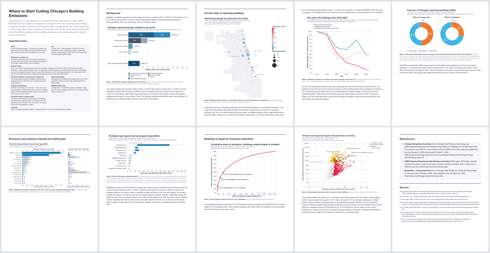

# Chicago Building Energy Analysis

### Author: Christine Tsai

## Description

This project seeks to find where Chicago can potentially cut emissions from its
buildings, which produce about two-thirds of the City's greenhouse gas
emissions. This analysis uses Chicago Energy Benchmarking data to examine trends
in the City's large building energy use over time and by property types. It
shows where the reporting buildings are and how their emissions changed from
2018 to 2023, then compares fuels and property types to see what drives
emissions. It ends by picking out the biggest emitters, and the poorly rated
buildings among them, as places to start reducing emissions.



## How to run

From the repository root, run one command. It reads the files in `data/` and writes all eight charts as PNG files to `static-viz/charts/`:

```
uv run python src/final_graphs.py
```

The page `static-viz/index.html` links to those images. The PDF is printed from the page.


## Data Sources

- City of Chicago. (2025). *Chicago Energy Benchmarking* [Data set]. Chicago Data Portal. https://data.cityofchicago.org/Environment-Sustainable-Development/Chicago-Energy-Benchmarking/xq83-jr8c
  - Used for every chart except the sector totals. Saved in `data/Chicago_Energy_Benchmarking_20261001.csv` (downloaded October 1, 2026; last updated by the city February 5, 2025). Most charts use the 2023 data year, and the trend uses 2018 to 2023.
- Chicago Metropolitan Agency for Planning. (2022). *Regional greenhouse gas emissions inventory: Updated with 2019 data*. https://cmap.illinois.gov/wp-content/uploads/Greenhouse_Gas_Emission_Inventory_2022.pdf
  - Used for the citywide emissions by sector chart. The City of Chicago column of the report's "Regional greenhouse gas inventory" table (page 14, million metric tons CO2e) is saved in `data/cmap_2019_ghg_inventory.csv`. `data/chicago_emissions_by_sector_2019.csv` groups those rows into the pieces the chart shows:
    - Residential buildings, commercial and institutional buildings, on-road vehicles, and waste are copied directly from the table.
    - "Industry & other" is shown as its own sector, separate from buildings. It is the stationary energy total (18.72) minus residential (6.55) and commercial and institutional (10.45), which leaves 1.72 (mostly manufacturing, wastewater, and fugitive emissions).
    - "Other" transportation is the transportation total (7.76) minus on-road (5.11), which leaves 2.65 (aviation, rail, and off-road).
    - The six pieces add up to CMAP's citywide total of 27.49.
- City of Chicago. (2026). *Boundaries - Community Areas* [Data set]. Chicago Data Portal. https://data.cityofchicago.org/resource/igwz-8jzy
  - Used for the community area shapes and centers in the bubble map. Saved in `data/chicago_community_areas.geojson`; `src/final_graphs.py` downloads it from the portal if the file is missing. Last updated by the city March 25, 2026.
- U.S. Environmental Protection Agency. (2026). *Greenhouse Gas Equivalencies Calculator: Calculations and References* (last updated August 4, 2026; accessed October 2026). https://www.epa.gov/energy/greenhouse-gases-equivalencies-calculator-calculations-and-references
  - Used for the "equivalent cars driven for a year" comparison: 4.29 metric tons CO2e per gasoline-powered passenger vehicle per year (`TONS_CO2E_PER_CAR_YEAR` in `src/final_graphs.py`).


## How feedback was incorporated

The draft charts and peer feedback are in `milestones/`.

| Draft chart | Current chart number | What changed in the final |
|---|---|---|
| 1. Building dot map | Figure 2 | Replaced with a bubble map by community area with circle size as the number of buildings and color as the share of poorly rated buildings. Ratings are grouped as poorly rated or not, and areas with few buildings are hollow gray. Emissions were removed from this chart. |
| 2.1 Choropleth | Removed | Removed |
| 2.2 Choropleth | Figure 2 | Figure 2 labels notable community areas. |
| 3. GHG choropleth | Removed | Removed |
| 4. Emissions by type | Figure 5 | Figure 5 puts the average emissions per building next to the total for each type. |
| 5. Box plot by type | Figure 6 | Figure 6's caption explains the box, the white median line and the whiskers, and a labeled dashed line marks the median of all buildings. |
| 6. Building age scatter | Removed | Removed |
| 7. Rating stacked bar | Figures 2 and 8 | Replaced by two groups, poorly rated (1 star) or not. |
| 8. Fuel mix | Figure 4 | Figure 4 groups the small fuels as "Other fuels" and labels them. Long property type names are shortened. The chart is converted to two donuts to show overall emissions instead. |
| 9. Same-building trend | Figure 3 | Figure 3 uses plain labels ("energy used per square foot"), labels the line ends, and the terms box defines the emission factor and related terms. |
| 10. Pareto curve | Figure 7 | Title was updated to be more readable. |
| 11. Priority buildings | Figure 8 | TBD. |
