# Chicago Building Energy Analysis

Christine Tsai

## What is your current goal? Has it changed since the proposal?

My initial proposal was focused on an equity and environmental justice angle, hypothesizing that buildings with worse energy ratings and higher GHG emissions would be in lower income neighborhoods. Once I started visualizing the data, I realized that there wasn't an obvious difference between buildings in different community areas, partially because there aren't enough buildings in each area to see a noticeable trend. I would also have to merge this dataset with income and demographic data to get an accurate equity picture.

My goal has shifted to analyzing Chicago's overall energy transition and creating a policy proposal that identifies a specific set of buildings to target for emissions and energy improvements. This analysis will also examine trends in emissions vs building types.

## Are there data challenges you are facing? Are you currently depending on mock data?

There are a lot of community areas (77) and a lot of property types, both of which are difficult to display on a chart. Community areas have to be mapped or shown in a choropleth. For property types, I decided to take the top 24 property types because I wanted to include data centers (though there are only 5 of these in Chicago). This is still a lot of property types so I might have to increase my cutoff to the top 15 types or figure out how to condense the types into larger subcategories.

There are also a lot of buildings that haven't submitted data. I might add a graph including these buildings to see if there's a trend between non-reporters and building types. There are some records that are missing data so I might need to do another cleaning step.

## Describe each of the provided images with 2-3 sentences to give the context and how it relates to your goal.

### 1. Buildings by emissions
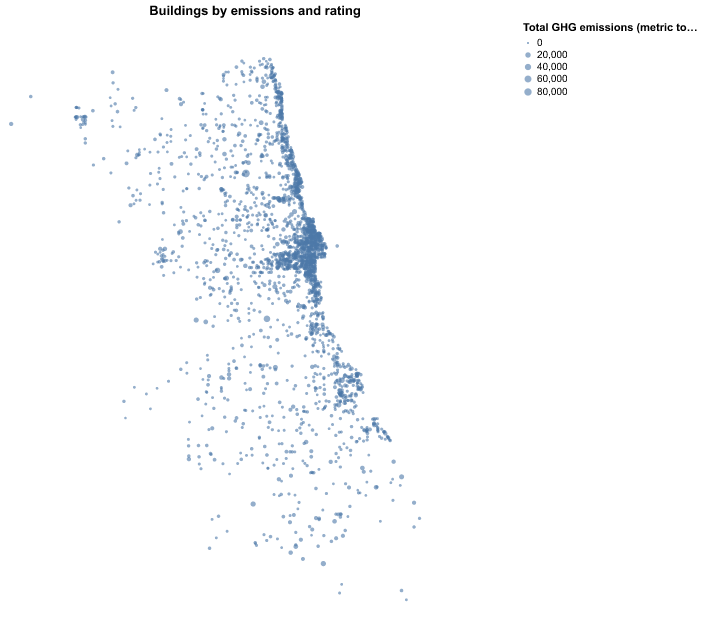
 
Each dot is a covered building, sized by its total greenhouse gas emissions. The biggest dots cluster downtown: the Near North Side and the Loop each account for about a quarter of reported emissions, and the Near West Side for about 12%. This gives an overview of where buildings tend to be clustered.
 
### 2.1 Median number of buildings per property
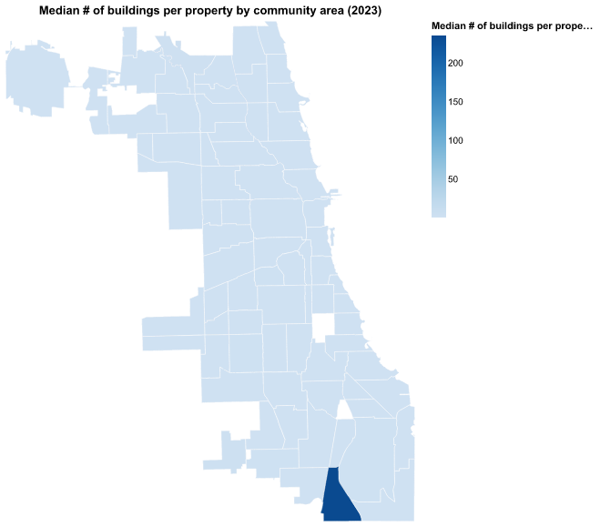
 
This map shows the median number of buildings per property in each community area. The map is pretty uniform because most properties contain a single building with a few exceptions for campuses and housing complexes. This map will likely be omitted from the final draft.
 
### 2.2 Number of reporting properties
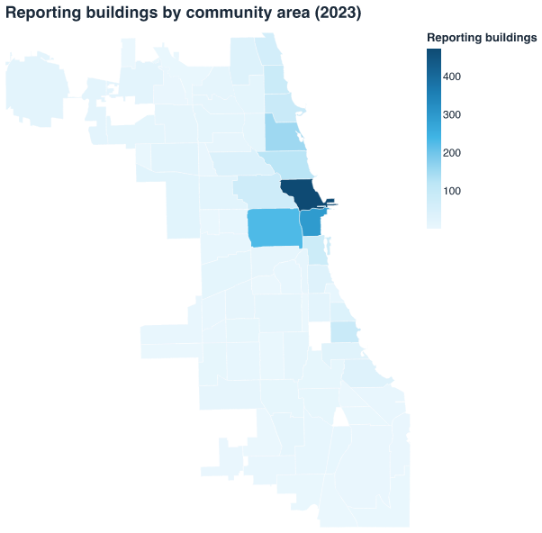
 
This map counts reporting properties per community area. The map shows that building density is concentrated around the Near North Side, the Loop, and Near West Side.
 
### 3. Where are the least efficient buildings?
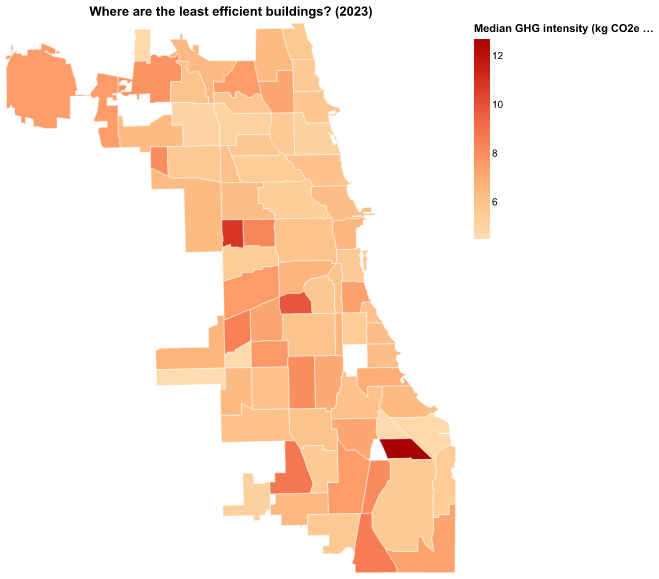
 
This map shades each community area by its median GHG intensity or emissions per square foot. The darkest community areas only have two or three buildings which shows the differences between community areas is less than expected. Focusing on individual buildings/properties will likely be more fruitful than focusing on specific community areas.
 
### 4. Which property types emit the most?
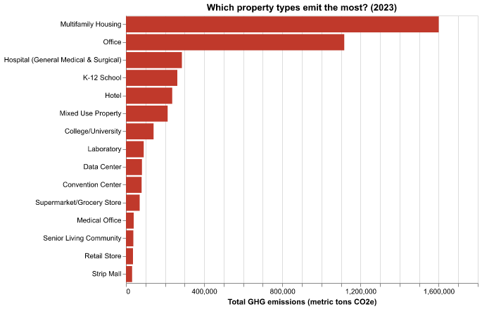
 
This chart ranks property types by their combined emissions. Multifamily housing and offices emit the most, followed by hospitals, K-12 schools, and hotels. This starts to put together the picture of where emissions are concentrated but doesn't yet account for the ratio in square footage to emissions.
 
### 5. Variation in emissions within building types
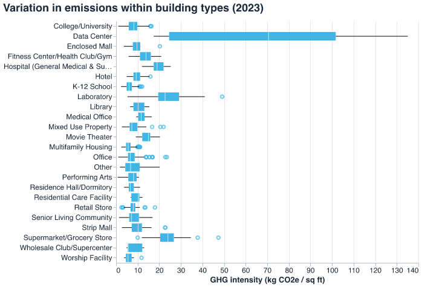
 
This box plot shows the spread of GHG intensity within each of the 24 most common property types. The highest medians belong to types with few buildings, such as data centers (about 71, from 5 buildings), supermarkets, laboratories, and hospitals, while multifamily housing, K-12 schools, and offices have lower GHG intensity. This identifies that buildings with the most total emissions are not necessarily the most intense emitters per square foot.
 
### 6. Do older buildings use more energy per square foot?
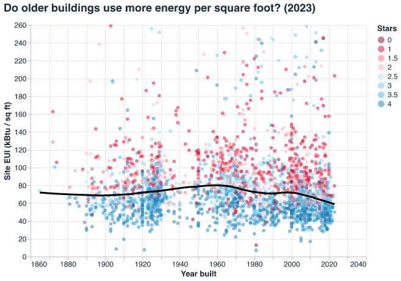
 
Each dot is a building, with year on the x-axis and site energy use per square foot on the y-axis. The dot color shows the building's star rating. There appears to be a slight decrease in energy use for buildings built after the 2000s but the relationship is weak. This means age is less of a determiner of energy efficiency for identifying buildings to target from a policy perspective.
 
### 7. Chicago Energy Rating mix by property type
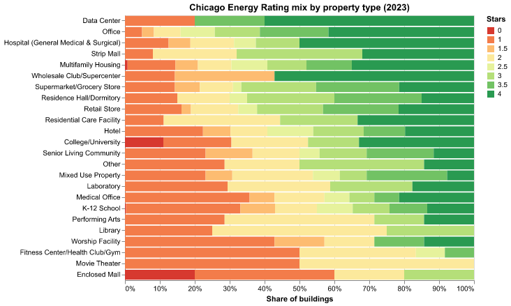
 
Each bar shows the share of rated buildings at each star level with types ordered by average rating. There are a few building types that have a larger share of low ratings (movie theaters, enclosed malls, fitness centers) but the poor ratings are spread throughout most building types. More analysis is needed to see if this gives any policy indication.
 
### 8. Fuel mix by property type
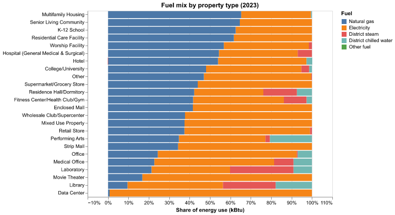
 
This chart shows each property type's share of energy from each fuel type. Natural gas and electricity make up almost all of it, and district steam and chilled water are reported by only 2 to 3% of buildings. Housing, senior living, and schools get roughly 62 to 65% of their energy from gas, while data centers use almost entirely electricity. This potentially identifies heating as a large source of emissions.
 
### 9. The same buildings, 2018 to 2023
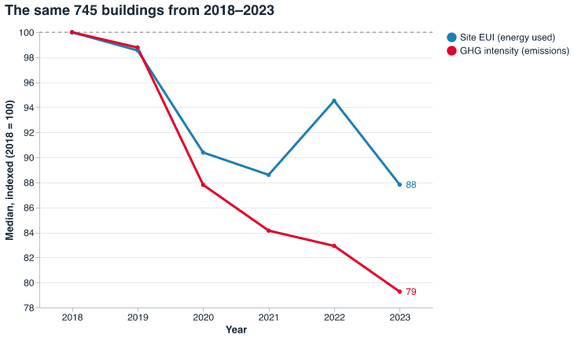
 
This chart follows the 745 buildings that reported in every year from 2018 to 2023. By 2023 their median GHG intensity has fallen to 79, while median site energy use has fallen only to 88. The same buildings improved over time, and emissions fell faster than energy use, which may show a transition to cleaner energy. Because these are buildings that submitted reports, the results might be biased and require further analysis.
 
### 10. Pareto curve of cumulative emissions
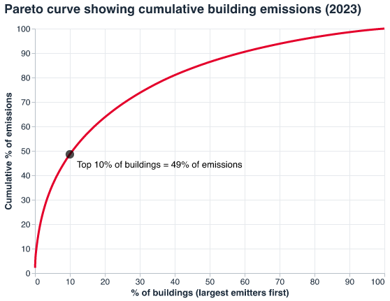
 
Buildings are sorted from largest to smallest emitter, and the line shows the cumulative share of total emissions. The top 1% of buildings produce about 16% of emissions, the top 5% about 36%, and the top 10% about 49%. This concentration forms the core of the policy argument since we can identify that a small number of buildings account for almost half of total emissions.
 
### 11. What is the overlap between the top emitters and poor rated buildings?
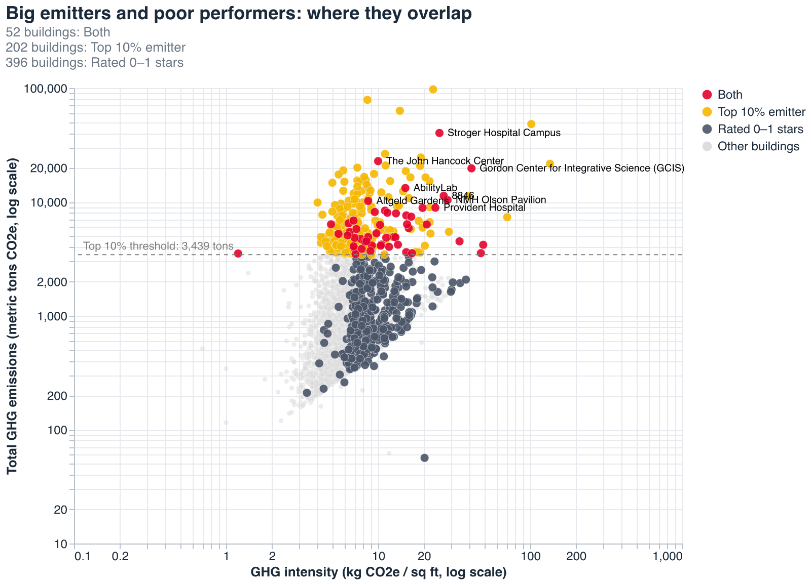
 
This chart plots every building by emissions intensity and total emissions, highlighting the top 10% of emitters, buildings that have 0 to 1 star ratings, and then the 52 that are included in both categories. Each of these 52 buildings is a top emitter with a poor rating and are potential targets for policy improvements.

## What form do you envision your final narrative taking? (e.g. An article incorporating the images? A poster? An infographic?)
I envision my final narrative as a mix between policy brief and article that follows a linear policy journey.